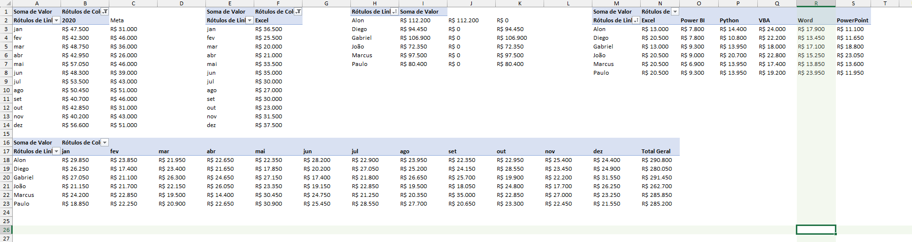

# Dashboard de Vendas - Excel

Dashboard interativo de análise de vendas construído em **Microsoft Excel**, com mais de **3.600 registros** de vendas entre 2019 e 2021.


---

## 📊 Visão Geral

Este projeto transforma uma base de dados transacional em um painel visual completo para análise comercial. Ideal para quem busca um exemplo prático de **Business Intelligence com Excel**.

### O que o dashboard entrega:

- Evolução mensal e anual de vendas
- Performance detalhada por **vendedor**
- Análise por **produto** (Python, Excel, VBA, Power BI, Word, PowerPoint)
- Distribuição por **região** (Norte, Nordeste, Centro-Oeste, Sudeste, Sul)
- Comparativo com **metas**
- Visualizações interativas com **9 gráficos**

---

## 📸 Preview do Dashboard



---

## 🛠️ Tecnologias e Recursos Utilizados

| Recurso | Uso no Projeto |
|---------|----------------|
| **Tabelas Estruturadas** | Base de dados organizada e dinâmica |
| **Tabelas Dinâmicas** | Análises agregadas por múltiplas dimensões |
| **Gráficos** | 9 gráficos (barras + linhas) |
| **Segmentações de Dados** | Filtros interativos |
| **Cálculos e KPIs** | Métricas de performance e metas |

---

## 📁 Estrutura do Projeto

```
sales-dashboard-excel/
├── README.md
├── Dashboard_Vendas.xlsx          # Arquivo principal do dashboard
└── screenshots/
    └── image.png                   # Preview do dashboard
```

### Abas do arquivo Excel:

| Aba | Conteúdo |
|-----|----------|
| **Base** | Dados transacionais (3.670 linhas) — Data, Ano, Mês, Vendedor, Cliente, Região, Produto, Valor |
| **Análise** | Tabelas dinâmicas e cálculos de apoio |
| **Dashboard** | Painel visual com 9 gráficos interativos |

---

## 🔍 Principais Insights

> Substitua pelos insights reais que você extraiu ao analisar os dados.

- Identifique o vendedor com melhor desempenho acumulado no período
- Produto com maior participação no faturamento
- Região que concentra a maior fatia das vendas
- Meses com melhor e pior performance vs. meta
- Ticket médio e evolução ao longo dos anos

---

## 📥 Como usar

1. Baixe o arquivo [`Dashboard_Vendas.xlsx`](Dashboard_Vendas.xlsx)
2. Abra no **Excel 365**, Excel 2021 ou superior (recomendado)
3. Navegue até a aba **Dashboard**
4. Utilize as segmentações de dados para filtrar por ano, vendedor, produto ou região

---

## 👤 Autor

**Marcos Monteiro**  
Espírito Santo, Brasil  

[](https://www.linkedin.com/in/seu-perfil)
[](https://github.com/Marcosmto)

---

## 📈 Sobre o Portfólio

Este projeto faz parte do meu portfólio de **Análise de Dados e Excel Avançado**.  
Foi desenvolvido com foco em:

- Estruturação correta de dados
- Storytelling visual
- Análise comercial prática
- Interatividade com o usuário final

Sinta-se à vontade para explorar, baixar e adaptar!
